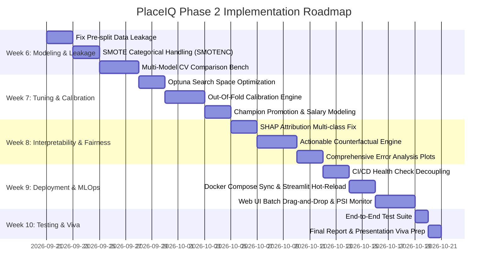

# PlaceIQ — Comprehensive Phase 2 Implementation Plan

This implementation plan incorporates all technical enhancements, mathematical bug fixes, fairness constraints, and deployment hardening identified in the project audit, directly mapped into the **Phase 2 Academic Review & CIE Timeline (Weeks 6–10)**.

---

## 📅 Timeline & CIE Deliverables Mapping

| Week | Date Window | Focus Area | Official Deliverable | Key Improvements Integrated |
|:---|:---|:---|:---|:---|
| **Week 6** | 21 Sep – 27 Sep | Model Comparison & Deeper Experimentation | ≥ 3 ML Models Compared | • Data leakage elimination in `src/data.py`<br>• Categorical-safe SMOTE (`SMOTENC`)<br>• Repeated Stratified K-Fold comparison |
| **Week 7** | 28 Sep – 04 Oct | Hyperparameter Tuning & Model Selection | Tuned Champion Model | • Out-of-fold probability calibration<br>• Optuna TPE tuning refinements<br>• Salary XGBRegressor margin stabilization |
| **Week 8** | 05 Oct – 11 Oct | Final Evaluation & Error Analysis | Evaluation & Interpretation | • SHAP multi-class slicing fix in `src/predict.py`<br>• Actionable & ethical counterfactual engine<br>• Multi-metric error & residual analysis |
| **Week 9** | 12 Oct – 18 Oct | Dual Deployment & GitHub CI/CD | Working App + GitHub Repo | • Decoupled liveness/readiness probes in CI<br>• Dynamic model reload in Docker Compose<br>• Streamlit hot-reload & Web UI drag-drop CSV |
| **Week 10** | 19 Oct – 20 Oct | Demonstration, Viva & Final Report | Phase 2 Final Evaluation | • End-to-end integration test suite<br>• Final `reports/project_report.md` update<br>• Viva presentation deck & demo runbook |

---



---

## Detailed Milestone Tasks

### 📍 Week 6 (21st Sep): Model Comparison & Deeper Experimentation

#### Task 6.1: Eliminate Pre-Split Imputation Leakage
- **Target File:** [`src/data.py`](file:///c:/Users/M%20S/Desktop/ml%20project/src/data.py)
- **Problem:** [`src/data.py:L155-159`](file:///c:/Users/M%20S/Desktop/ml%20project/src/data.py#L155-L159) currently computes whole-dataset medians across the merged data prior to the train/test split.
- **Action:**
  - Remove dataset-wide imputation from `merge_datasets()`.
  - Let missing values pass through cleanly into [`src/features.py`](file:///c:/Users/M%20S/Desktop/ml%20project/src/features.py), where `SimpleImputer(strategy="median")` is fitted strictly on `X_train`.

#### Task 6.2: Categorical-Safe Resampling
- **Target File:** [`src/tuning.py`](file:///c:/Users/M%20S/Desktop/ml%20project/src/tuning.py), [`src/ensemble.py`](file:///c:/Users/M%20S/Desktop/ml%20project/src/ensemble.py)
- **Problem:** Standard `SMOTE` creates fractional values for one-hot encoded binary variables.
- **Action:**
  - Use `SMOTENC` from `imblearn.over_sampling` with categorical column indices, or balance classes via algorithmic weights (`scale_pos_weight` in XGBoost, `class_weight="balanced"` in Sklearn models) before synthetic generation.

#### Task 6.3: Candidate Benchmark & Repeated Cross-Validation
- **Target Files:** [`src/ensemble.py`](file:///c:/Users/M%20S/Desktop/ml%20project/src/ensemble.py), [`src/train.py`](file:///c:/Users/M%20S/Desktop/ml%20project/src/train.py)
- **Action:**
  - Benchmark at least 5 distinct algorithm families:
    1. Logistic Regression (L2 regularized baseline)
    2. Random Forest Classifier
    3. Gradient Boosting Classifier
    4. XGBoost Classifier
    5. Support Vector Classifier (RBF kernel with Platt scaling)
    6. Voting Ensemble (soft probability voting)
    7. Stacking Ensemble with LogisticRegression meta-classifier
  - Standardize CV evaluation with `RepeatedStratifiedKFold(n_splits=5, n_repeats=3, random_state=42)` across ROC-AUC, F1, and Brier Score.

---

### 📍 Week 7 (28th Sep): Hyperparameter Tuning & Model Selection

#### Task 7.1: Optuna Hyperparameter Optimization Refinement
- **Target File:** [`src/tuning.py`](file:///c:/Users/M%20S/Desktop/ml%20project/src/tuning.py)
- **Action:**
  - Enhance Optuna parameter search spaces for tree models (`min_child_weight`, `gamma`, `colsample_bytree`) and SVC (`C`, `gamma`).
  - Add early stopping and pruning via `MedianPruner` to accelerate trials.
  - Store study parameter importances to display in Model Info tabs.

#### Task 7.2: Out-Of-Fold (OOF) Probability Calibration
- **Target File:** [`src/ensemble.py`](file:///c:/Users/M%20S/Desktop/ml%20project/src/ensemble.py)
- **Problem:** Currently, calibrators (`IsotonicRegression` / `LogisticRegression`) are fitted on `X_train_t` probabilities generated by a model already fitted on `X_train_t`, causing extreme overconfidence.
- **Action:**
  - Generate out-of-fold prediction probabilities using `cross_val_predict(cv=5, method="predict_proba")` on the training set.
  - Fit the calibration curves strictly on these out-of-fold probabilities, preventing in-sample memorization.

#### Task 7.3: Champion Selection & Salary Regressor Hardening
- **Target Files:** [`src/experiments.py`](file:///c:/Users/M%20S/Desktop/ml%20project/src/experiments.py), [`src/salary.py`](file:///c:/Users/M%20S/Desktop/ml%20project/src/salary.py)
- **Action:**
  - Automatically evaluate candidate models on validation ROC-AUC + Brier score to auto-promote the champion.
  - Stabilize `SalaryPredictor` with Huber loss or log-transformed target (`log(salary)`) to reduce sensitivity to outlier high-salary packages.

---

### 📍 Week 8 (5th Oct): Final Evaluation, SHAP & Error Analysis

#### Task 8.1: Fix SHAP Attribution Positive-Class Slicing
- **Target File:** [`src/predict.py`](file:///c:/Users/M%20S/Desktop/ml%20project/src/predict.py)
- **Problem:** `np.asarray(shap_values).reshape(-1)` in [`src/predict.py:L97`](file:///c:/Users/M%20S/Desktop/ml%20project/src/predict.py#L97) extracts class 0 ("Not Placed") attributions when using multi-class tree models.
- **Action:**
  - Correctly slice positive class attribution:
    ```python
    shap_arr = np.asarray(shap_values)
    if isinstance(shap_values, list) and len(shap_values) == 2:
        shap_arr = shap_values[1]
    elif shap_arr.ndim == 3 and shap_arr.shape[-1] == 2:
        shap_arr = shap_arr[0, :, 1]
    flat = np.asarray(shap_arr).reshape(-1)
    ```
  - Standardize `base_probability` so models outputting probabilities don't get passed through an unnecessary second sigmoid.

#### Task 8.2: Actionable & Ethical Counterfactual Explanations
- **Target File:** [`src/counterfactual.py`](file:///c:/Users/M%20S/Desktop/ml%20project/src/counterfactual.py)
- **Action:**
  - Guard against `None` values in optional Kumbhar attributes.
  - Partition attributes into:
    - **Immutable / Non-Actionable:** `gender`, `tenth_b`, `twelfth_b`, `tenth_p`, `twelfth_p`, `has_masters`, `masters_type` (cannot advise candidate to change demographic, past school records, or completed degrees).
    - **Actionable / Modifiable:** `internships`, `projects`, `workshops`, `soft_skills`, `etest_p`, `degree_p`, `mba_p`.
  - Apply scale-specific bounds and step increments:
    - CGPA / Soft Skills: range 0–10, steps [0.2, 0.5, 1.0]
    - Projects / Internships: integers, steps [1, 2]
    - Percentages: range 0–100, steps [2.0, 5.0, 8.0]

#### Task 8.3: Error Analysis & Diagnostic Visualizations
- **Target File:** [`src/eval.py`](file:///c:/Users/M%20S/Desktop/ml%20project/src/eval.py)
- **Action:**
  - Save full diagnostic suite in `models/runs/<run_id>/plots`:
    - ROC Curve with AUC & optimal threshold marker
    - Precision-Recall Curve with baseline AP
    - Calibration Curve (Reliability Diagram) with Brier Score
    - Confusion Matrix (Normalized & Raw counts)
    - Learning Curves across training sample increments
    - Permutation Importance vs SHAP Global Importance comparison

---

### 📍 Week 9 (12th Oct): Deployment (Streamlit + FastAPI), CI/CD & GitHub

#### Task 9.1: Fix CI/CD Pipeline & Health Check Decoupling
- **Target Files:** [`app/main.py`](file:///c:/Users/M%20S/Desktop/ml%20project/app/main.py), [`.github/workflows/ci.yml`](file:///c:/Users/M%20S/Desktop/ml%20project/.github/workflows/ci.yml)
- **Action:**
  - Create `/api/health` as a standard liveness probe (returns HTTP 200 `{"status": "ok"}`).
  - Create `/api/ready` as a readiness probe (returns HTTP 200 if model loaded, HTTP 503 if training needed).
  - Update GitHub Actions workflow to check `/api/health` so container smoke tests pass on clean checkouts.

#### Task 9.2: Docker Compose Synchronization & Model Hot-Reload
- **Target Files:** [`docker-compose.yml`](file:///c:/Users/M%20S/Desktop/ml%20project/docker-compose.yml), [`app/main.py`](file:///c:/Users/M%20S/Desktop/ml%20project/app/main.py)
- **Action:**
  - In `app/main.py`, make `require_model()` attempt a lazy reload from disk if `predictor is None` (checking if `models/bundle.joblib` has appeared).
  - Provide an `/api/admin/reload` endpoint so retraining triggers immediate memory reload without container restarts.

#### Task 9.3: Streamlit UI Cache Management
- **Target File:** [`app/streamlit_app.py`](file:///c:/Users/M%20S/Desktop/ml%20project/app/streamlit_app.py)
- **Action:**
  - Add a "Refresh Model Artifacts" button in the sidebar using `st.cache_resource.clear()`.
  - Display active model version, trained timestamp, and threshold in the sidebar.

#### Task 9.4: Static Web UI Enhancements
- **Target Files:** [`app/static/index.html`](file:///c:/Users/M%20S/Desktop/ml%20project/app/static/index.html), [`app/static/app.js`](file:///c:/Users/M%20S/Desktop/ml%20project/app/static/app.js)
- **Action:**
  - Add CSV drag-and-drop batch upload in the Batch scoring panel.
  - Replace native browser alerts with non-blocking toast notifications.
  - Ensure theme preference (Dark / Light) persists in `localStorage`.

#### Task 9.5: Safe Prediction Logging & PSI Drift Monitoring
- **Target File:** [`src/monitor.py`](file:///c:/Users/M%20S/Desktop/ml%20project/src/monitor.py)
- **Action:**
  - Guard prediction logging with file locks or background task buffering to prevent multi-worker concurrency race conditions.

---

### 📍 Week 10 (20th Oct): Comprehensive Testing, Report & Viva Prep

#### Task 10.1: Test Suite Expansion
- **Target Files:** [`tests/`](file:///c:/Users/M%20S/Desktop/ml%20project/tests)
- **Action:**
  - Add unit tests for:
    - `tests/test_salary.py`: Salary prediction, band classification (`low`/`mid`/`high`), residual bounds.
    - `tests/test_counterfactual.py`: Handling `None` fields, immutable attribute invariance, convergence.
    - `tests/test_monitor.py`: PSI calculation and drift threshold severity alerts.
  - Add an end-to-end integration test (`tests/test_pipeline_e2e.py`) running a quick train-predict-explain cycle on synthetic data.

#### Task 10.2: Final Project Report Updating
- **Target File:** [`reports/project_report.md`](file:///c:/Users/M%20S/Desktop/ml%20project/reports/project_report.md)
- **Action:**
  - Complete all Phase 2 report sections:
    - §2.1: Model comparison table across 5 algorithms + ensembling.
    - §2.2: Optuna hyperparameter tuning methodology and champion selection.
    - §2.3: Final test evaluation metrics, confusion matrix, and SHAP interpretation.
    - §2.4: Dual deployment architecture (FastAPI REST backend + Streamlit UI).
    - §2.5: Conclusion, error analysis, ethical considerations, and future work.

#### Task 10.3: Presentation & Demonstration Runbook
- **Action:**
  - Prepare a 10-slide summary aligning with `Phase1_Review_PPT_Template.pptx` structure for Phase 2.
  - Document a 3-minute live demonstration script covering:
    1. Single prediction form with live animated gauge.
    2. SHAP waterfall explanation showing top positive & negative contributors.
    3. Counterfactual suggestion (e.g. how an extra internship / improved test score flips outcome).
    4. Model comparison table and PSI feature drift monitor.

---

## 🎯 Verification & Quality Gates

| Gate | Acceptance Criteria |
|:---|:---|
| **Code Quality** | `ruff check src/ app/ tests/` passes with 0 errors. |
| **Unit & Integration Tests** | `pytest tests/ -v` passes 100% of tests. |
| **Model Reproducibility** | `python scripts/train_all.py` successfully executes end-to-end and outputs all joblib & plot artifacts. |
| **API Health & Endpoints** | All 8 FastAPI endpoints return valid status codes and JSON schemas on test payloads. |
| **Streamlit Deployment** | `streamlit run app/streamlit_app.py` runs cleanly without exceptions. |
| **Docker Build** | `docker build -t placement-predictor .` succeeds and passes the liveness test. |
